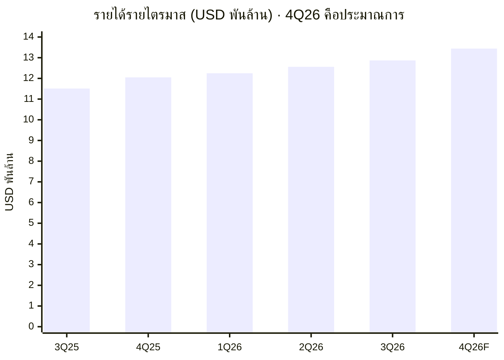
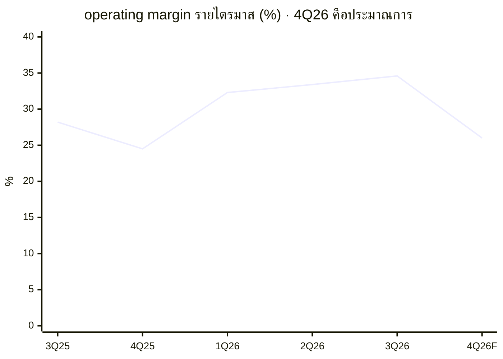
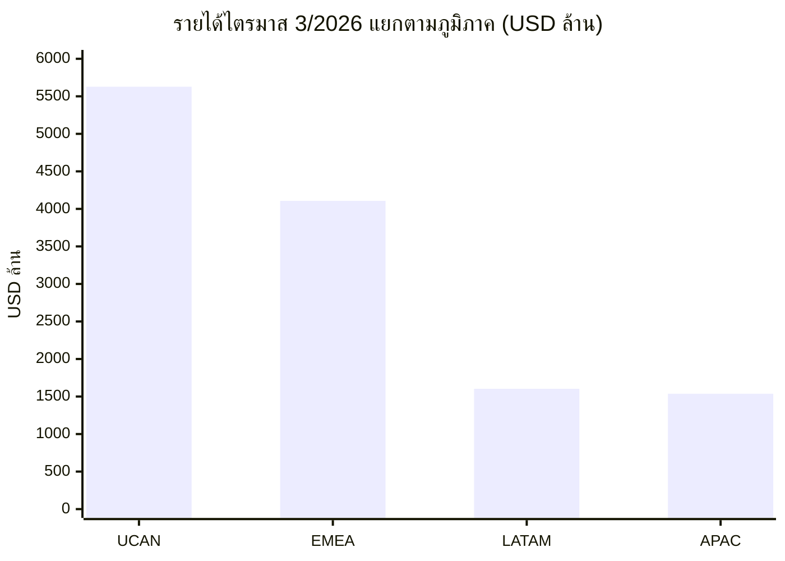

# จดหมายผู้ถือหุ้น Netflix ไตรมาส 3/2026: margin สูงสุดของปี แต่ไตรมาส 4 จะลดลง และโฆษณาโตช้ากว่าแผน

## สรุปสั้นก่อนอ่าน

ทุกไตรมาส Netflix ออก **shareholder letter (จดหมายถึงผู้ถือหุ้น)** วันเดียวกับที่ประกาศงบ จดหมายฉบับไตรมาส 3/2026 (ก.ค.–ก.ย.) ลงวันที่ 20 ต.ค. 2026 ยาว 13 หน้า ห้าหน้าแรกเป็นคำอธิบายของบริษัท หน้า 6 เป็นรายได้แยกตามภูมิภาค ที่เหลือเป็นงบการเงิน เรื่องหลักมีสามเรื่อง รายได้ไตรมาสนี้ USD 12,874 ล้าน โต 11.8% และ operating margin ขึ้นไปที่ 34.6% แต่บริษัทคาดว่า margin ไตรมาส 4 จะลงมาที่ 26.0% และลดเป้ารายได้โฆษณาทั้งปีจากราว USD 3 พันล้าน เหลือราว USD 2.7 พันล้าน (หน้า 1–2)

## จดหมายต่างจาก 10-Q อย่างไร

[[nflx-10q-2026q3|10-Q]] เป็นรายงานที่ยื่นต่อ SEC ตามแบบฟอร์มบังคับ ส่วนจดหมายเป็นเอกสารที่บริษัทเขียนเองเพื่อเล่าว่าไตรมาสนี้เกิดอะไรขึ้นและคาดอะไรต่อ จดหมายจึงมีสองอย่างที่ 10-Q ไม่มี คือ **forecast (ประมาณการของบริษัท)** ของไตรมาสถัดไปและทั้งปี กับตารางสรุป 5 ไตรมาสย้อนหลังในหน้าแรก ซึ่งทำให้เห็นแนวโน้มได้ในหน้าเดียว ข้อควรระวังคือเนื้อหาเป็นมุมของบริษัท ประโยคที่อธิบายสาเหตุจึงนับเป็นคำอธิบายของบริษัท ต้องเทียบกับตัวเลขก่อนนำไปใช้

## รายได้โตช้าลงทีละไตรมาส แต่ยังโตสองหลัก

ตารางหน้าแรกแสดงรายได้ 5 ไตรมาสกับ forecast ไตรมาส 4 ตัวเงินเพิ่มขึ้นทุกไตรมาส แต่อัตราโตเทียบปีก่อนลดลงต่อเนื่อง จาก 17.6% ในไตรมาส 4/2025 เหลือ 11.8% ในไตรมาส 3/2026 และคาดว่า 11.5% ในไตรมาส 4 (หน้า 1)

*วาดจากตารางสรุปหน้า 1 ซึ่งพิมพ์เป็น USD ล้าน หารด้วย 1,000 · แท่งสุดท้ายเป็น forecast ของบริษัท ไม่ใช่ผลจริง*

บริษัทอธิบายว่ารายได้ไตรมาสนี้มาจากจำนวนสมาชิกที่เพิ่ม การขึ้นราคา รายได้โฆษณา และค่าเงินที่ช่วยหลังหักการ hedge และบอกว่า **churn (อัตราที่สมาชิกยกเลิก)** ดีขึ้นทั้งในสหรัฐและทั่วโลก (หน้า 2) จดหมายไม่ได้บอกจำนวนสมาชิก เพราะ Netflix เลิกรายงานตัวเลขนี้ตั้งแต่ปี 2025 ตามที่ [[nflx-10k-2025]] ระบุไว้

## margin ขึ้นสูงสุดในไตรมาสนี้ แล้วจะลงในไตรมาส 4

**operating margin** คือกำไรจากการดำเนินงานหารด้วยรายได้ ไตรมาสนี้อยู่ที่ 34.6% สูงสุดในตาราง และสูงกว่าที่บริษัทคาดไว้ บริษัทให้เหตุผลหลักว่าเป็นเรื่องจังหวะการลงค่าใช้จ่าย คือค่าใช้จ่ายบางส่วนเลื่อนไปไตรมาสอื่น ไม่ใช่ต้นทุนที่หายไป (หน้า 1–2) กราฟด้านล่างจึงขึ้นลงเป็นรอบ ไตรมาส 4 ของทั้งสองปีต่ำกว่าไตรมาสอื่น

*ตัวเลขตามที่พิมพ์ในหน้า 1 · validator ตรวจแล้วว่าทุกไตรมาสเท่ากับ operating income หารรายได้ ภายในการปัดเศษ*

margin ไตรมาส 4 ที่คาดไว้ 26.0% รวมผลลบราว 120 **basis points (1.2 จุดเปอร์เซ็นต์)** จากการลดพนักงานที่เพิ่งประกาศ ทั้งปี 2026 บริษัทคาด margin 31.5% เทียบกับ 29.5% ในปี 2025 (หน้า 2) อ่านคู่กับ [[nflx-10q-2026q3-explained]] จะเห็นว่า margin ไตรมาส 3/2025 ที่ใช้เป็นฐานเทียบถูกกดด้วยภาษีในบราซิล ส่วนต่างระหว่าง 28.2% กับ 34.6% จึงไม่ได้มาจากการดำเนินงานทั้งหมด จดหมายฉบับนี้ไม่ได้พูดถึงภาษีบราซิลเลย

## โฆษณา: โตแต่ช้ากว่าที่บอกไว้

ประโยคที่ควรอ่านช้าๆ อยู่ในหน้า 2 บริษัทคาดรายได้ทั้งปี 2026 ที่ USD 51.1 พันล้าน ต่ำกว่าจุดกึ่งกลางของช่วงที่เคยให้ไว้ 0.2% รายได้ค่าสมาชิกดีกว่าคาด แต่รายได้โฆษณาทั้งปีคาดว่าจะได้ราว USD 2.7 พันล้าน จากที่เคยคาดราว USD 3 พันล้าน เพราะความสามารถบางส่วนของระบบโฆษณาออกช้ากว่าที่คิด (หน้า 2) เรื่องนี้ตรงกับที่ผู้บริหารพูดในคลิปว่าโฆษณาโตเร็วแต่ช้ากว่าเป้า ([[nflx-earnings-interview-2026q3]]) ฝั่งแผนต่อไป บริษัทจะเปิดแพ็กเกจที่มีโฆษณาเพิ่ม 15 ประเทศในปี 2027 โดยชุดแรกเริ่มเดือนมีนาคม 2027 (หน้า 4)

## รายได้มาจากภูมิภาคไหน

หน้า 6 แยกรายได้เป็นสี่ภูมิภาค **UCAN (สหรัฐและแคนาดา)** ยังเป็นก้อนใหญ่ที่สุด รองลงมาคือ **EMEA (ยุโรป ตะวันออกกลาง และแอฟริกา)** ส่วน LATAM (ละตินอเมริกา) กับ APAC (เอเชียแปซิฟิก) มีขนาดใกล้กัน

*ตัวเลขจากหน้า 6 · รวมสี่ภูมิภาคได้ 12,875 ต่างจากรายได้รวมหน้า 1 อยู่ 1 ล้านจากการปัดเศษ (validator ตรวจแล้ว)*

ถ้าคำนวณสัดส่วน UCAN คิดเป็นราว 43.7% ของรายได้ไตรมาสนี้ (คำนวณด้วย Python: 5,628 ÷ 12,874) LATAM โตเร็วที่สุดเมื่อวัดเป็นดอลลาร์ที่ 17% แต่ถ้าตัดผลค่าเงินออกเหลือ 12% และภูมิภาคที่โตเร็วที่สุดจะกลายเป็น APAC ที่ 15% (หน้า 6) ตัวเลขสองคอลัมน์นี้จึงต้องอ่านคู่กันเสมอ ตัวอย่างที่บริษัทยกขึ้นมาเองคืออินเดีย view hours โต 24% และรายได้โตราว 18% เมื่อตัดผลค่าเงิน (หน้า 4–5) แต่อินเดียไม่ได้แยกเป็นบรรทัดในตาราง

## เงินสดและการซื้อหุ้นคืน

**free cash flow (เงินสดจากการดำเนินงานหักเงินลงทุนในทรัพย์สิน)** ไตรมาสนี้ USD 2,884 ล้าน บริษัทลดประมาณการ FCF ทั้งปีเหลือราว USD 12.0 พันล้าน จากเดิม USD 12.5 พันล้าน เพราะคาดว่าจะปิดธุรกรรมอสังหาริมทรัพย์ในไตรมาส 4 ไตรมาสนี้ซื้อหุ้นคืน 63.9 ล้านหุ้นเป็นเงิน USD 4.8 พันล้าน มากที่สุดต่อไตรมาสที่เคยทำ และจบไตรมาสด้วยหนี้รวม USD 15.3 พันล้าน กับเงินสด USD 8.2 พันล้าน (หน้า 1, 5)

## อ่านจดหมายนี้ยังไงให้คุ้มเวลา

1. **หน้า 1** ตารางสรุป 5 ไตรมาสกับ forecast อ่านตารางก่อนอ่านข้อความ
2. **หน้า 2** ย่อหน้า Q3 Results and Forecast มีเหตุผลของ margin และเรื่องเป้าโฆษณา
3. **หน้า 6** รายได้รายภูมิภาค ดูคอลัมน์ F/X Neutral ควบคู่เสมอ
4. **หน้า 5** เงินสด หนี้ และการซื้อหุ้นคืน
5. หน้า 3–4 เป็นรายชื่อคอนเทนต์และกลยุทธ์ อ่านผ่านๆ ได้ ยกเว้นย่อหน้าเรื่อง view hours ในหน้า 4 ที่บริษัทยอมรับว่านักลงทุนกังวล

## สิ่งที่ vault ยังไม่มี

ยังไม่มีรายได้โฆษณาปี 2025 จึงตรวจคำว่า "โตเกิน 80%" จากคลิปไม่ได้ และจดหมายไม่ได้บอกว่าธุรกรรมอสังหาริมทรัพย์ในไตรมาส 4 คืออะไร ตาราง claim พร้อมเลขหน้าอยู่ใน [[nflx-letter-2026q3|source note]] ตัวเลขที่ใช้วาดกราฟอยู่ใน `facts/nflx-2026-q3-letter.json`

## เครดิตและแหล่งที่มา
- Netflix, Inc. *Q3 2026 Letter to Shareholders* ลงวันที่ 20 ต.ค. 2026 https://s22.q4cdn.com/959853165/files/doc_financials/2026/q3/FINAL-Q3-26-Shareholder-Letter.pdf (ยื่นเป็น Exhibit 99.1 ของ Form 8-K วันเดียวกัน)
- เลขหน้าคือหน้า PDF ตรวจกับข้อความต้นฉบับเมื่อ 2026-10-28 · ตัวเลขในตารางหน้า 1 และ 6 ผ่าน `scripts/validate_facts.py` (71 checks)
- ตัวเลขที่คำนวณเพิ่ม (หน่วยพันล้านในกราฟ · สัดส่วน UCAN 43.7%) คำนวณด้วย Python
- เพื่อการศึกษา ไม่ใช่คำแนะนำการลงทุน
